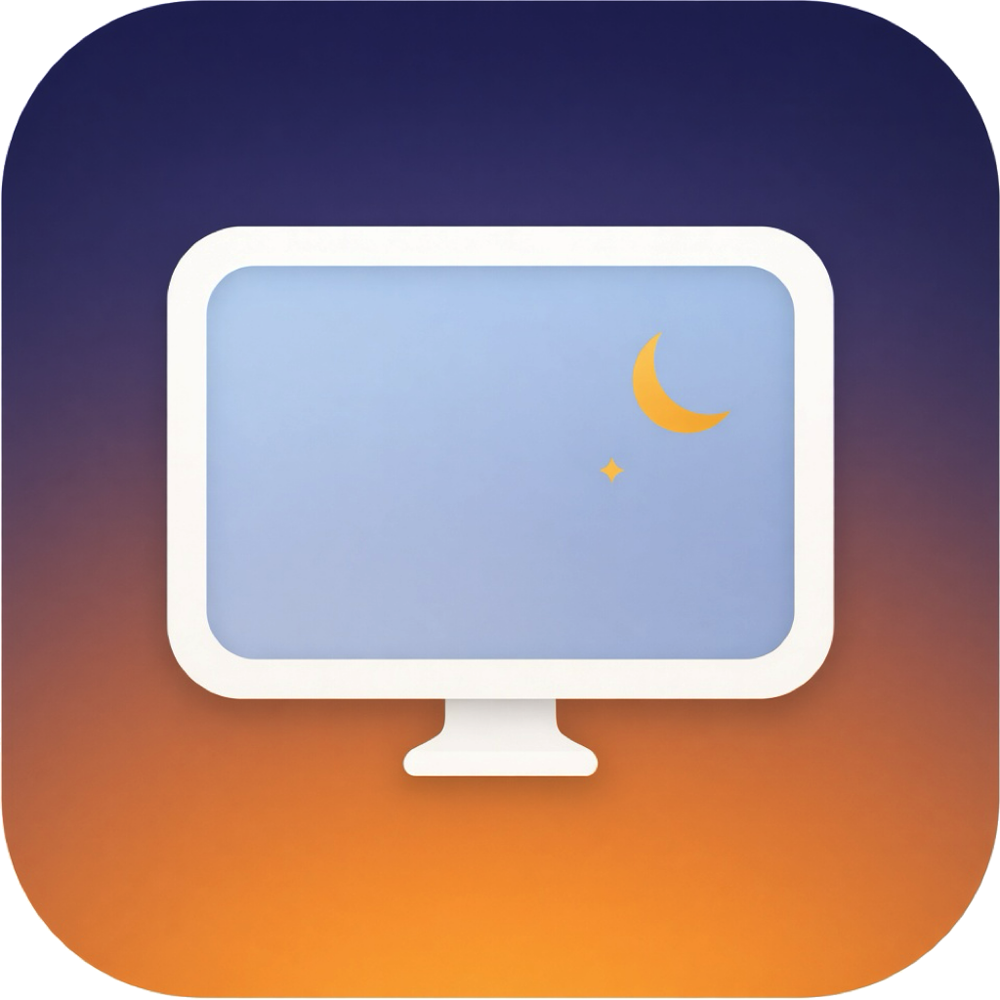
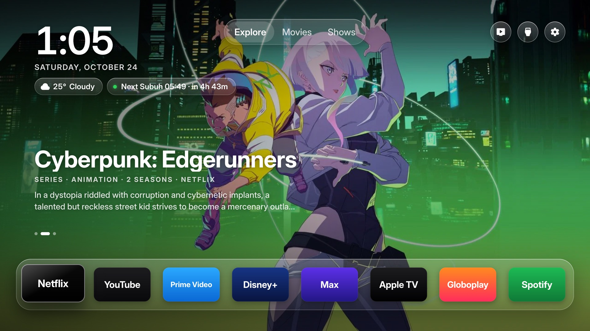

<div align="center">



# Samsung TV

**A quiet, ad-free home screen for Samsung Tizen TVs.**

Inspired by the clean glass of Apple TV. Your apps rest on a clear shelf, the weather is one press away, and in Malaysia the next JAKIM prayer time sits beside it.<br>
Samsung's own home screen stays where it is.

[**Website**](https://mkfadzli.github.io/samsung-tv/) · [Install](#install) · [Make it yours](#make-it-yours)



</div>

For Samsung TVs from 2017 on (Tizen 3 and newer). This repository is that app only.

## What you get

- **No ads.** No sponsored rows, banners, or autoplaying promos.
- **Your apps, on glass.** The streaming apps you actually open, on a clear shelf. Choose them and their order on the TV.
- **Trending, not sponsored.** Three fresh picks from what's trending this week and the latest releases, only from apps you already have. Movies and Shows get their own tabs.
- **Weather, and solat in Malaysia.** The forecast sits with the clock. When a JAKIM zone is set, the next prayer and the time left sit beside it.
- **Light by day, dark by night.** The screen follows your city's sunset.
- **A screensaver to match.** Full-screen photos of the picks, with a glass clock.
- **Nothing else on the TV changes.** No root. Picture, sound, and inputs stay as they are. Samsung's home screen stays. Delete the app when you want it gone.

## Install

About ten minutes. You need a Samsung TV from 2017 or newer and a computer on the same Wi-Fi.

1. **On the TV**, open **Apps** and type `1 2 3 4 5` on the remote. Turn **Developer mode** on, set **Host PC IP** to this computer's IP address, and restart the TV.
2. **On your computer**, clone this repository and set your city in `config.properties`. A free [TMDB key](#the-tmdb-key) adds the picks. Then build and sign:
   ```bash
   git clone https://github.com/mkfadzli/samsung-tv && cd samsung-tv
   python3 tizen/build.py --sign <profile>
   ```
   The first run creates `config.properties`. Fill in your city, then build again. On 2023 and newer TVs the certificate is made with your Samsung account, for this TV. On 2017–2022 TVs a Tizen certificate is enough. Updates must use the same certificate.
3. **Install:**
   ```bash
   python3 tizen/install.py 192.168.1.50 (please check and confirm your tv's IP address')
   ```
4. **Straight to it:** in the TV's settings, under Start Screen Options, turn on **Autorun Last App**. The TV turns on into Samsung TV.

To remove it: `python3 tizen/install.py 192.168.1.50 --uninstall`. If the TV does not answer that, delete Samsung TV from Apps.

## Make it yours

The first values come from `config.properties`. Language, the city, the temperature, Glass or Classic, the weather and prices cards, and the apps on the shelf can also be changed on the TV. The TV's choice wins.

| Key | What it does | Default |
|---|---|---|
| `tmdb_key` | Your free TMDB key, for the picks | empty |
| `tmdb_region` | Your country (two letters): which titles are on which app | `US` |
| `watchmode_key` | Optional, free [Watchmode](https://api.watchmode.com/) key: a pick opens the title's page in its app | empty |
| `latitude`, `longitude` | Your city, for the weather and the sunset | New York |
| `city` | The name on the weather card | empty |
| `prayer_zone` | A JAKIM zone, such as `SGR01`, for the next prayer. Empty hides it | empty |
| `home_style` | `glass` or `classic` | `classic` |
| `hide_animation` | Leave cartoons and anime out of the picks | `false` |
| `language` | `auto` (follows the TV), `en`, or `ms` (Bahasa Melayu) | `auto` |
| `show_crypto` | Show crypto prices on the home screen and the screensaver | `true` |
| `currency` | Prices in `USD`, `EUR`, `MYR`… | `USD` |
| `temperature` | `C`, `F`, or `auto` | `auto` |
| `hide_apps` | Apps to leave off the shelf, by id or by part of the name, comma separated | empty |

Changed something? Build and sign again with the same profile, then install again.

### The TMDB key

Free, and it takes two minutes: create an account at [themoviedb.org](https://www.themoviedb.org/signup), then open [Settings → API](https://www.themoviedb.org/settings/api) and request a developer key. Paste the *API Read Access Token* (or the *API Key*) after `tmdb_key=`. It's your key: `config.properties` stays out of git.

Without a key, everything works except the picks and the screensaver photos.

### Opening a title, not just its app (optional)

With a free [Watchmode](https://api.watchmode.com/) key (`watchmode_key=` in `config.properties`), a pick opens its own page in the streaming app instead of the app's home. Where the app does not take that address, the pick just opens the app.

## How it works

The home screen is a web app in [`web/`](web): plain HTML, CSS, and JavaScript, written for the browser in Tizen 3 and newer. No frameworks. Only transform and opacity animate.

[`tizen/build.py`](tizen/build.py) packs that app, with your `config.properties`, into `FreeMyTV-tizen.wgt`. [`tizen/install.py`](tizen/install.py) sends it to the TV. On the TV, `web/tv.js` lists and opens apps through Tizen, and switches the HDMI and tuner inputs.

To look at it on a computer: `python3 tizen/build.py --preview`, then open `out/tizen/index.html`. A stand-in lists sample apps.

| File | What it is |
|---|---|
| [`web/home.js`](web/home.js) | The home screen |
| [`web/home.css`](web/home.css) | Glass, the shelf, the clock, and the prayer pill |
| [`web/tv.js`](web/tv.js) | The TV's apps and inputs |
| [`tizen/build.py`](tizen/build.py) | The Samsung package |
| [`tizen/install.py`](tizen/install.py) | Install and uninstall over the TV's developer port |
| [`tizen/config.xml`](tizen/config.xml) | The app's name and id on the TV |

The website is in [`docs/`](docs): plain HTML, CSS, and JS on GitHub Pages.

## Languages

The app speaks English and Bahasa Melayu. *Automatic* follows the TV: a Malay TV uses Bahasa Melayu, and everything else stays in English. *Home Settings* → *Language* lists both.

Each language is one file, [`app/assets/i18n/<lang>.json`](app/assets/i18n), keyed by the English text. Bahasa Melayu is [`ms.json`](app/assets/i18n/ms.json). After changing on-screen text, run `python3 tools/translate.py` and fill any new Malay lines by hand. `python3 tools/translate.py --check` checks that every placeholder still matches.

## Privacy

No accounts, no analytics, no tracking. The app talks to TMDB, Open-Meteo (with the coordinates you set, or your time zone's main city), and Binance only when `show_crypto=true`, and Watchmode only when you set a `watchmode_key`. Your settings stay on your computer and your TV.

## Credits

- This product uses the TMDB API but is not endorsed or certified by [TMDB](https://www.themoviedb.org/).
- Prayer times in Malaysia come from JAKIM e-Solat.
- Links to the titles in the streaming apps by [Watchmode](https://api.watchmode.com/).
- Weather data by [Open-Meteo.com](https://open-meteo.com/) (CC BY 4.0). Prices from the [Binance](https://www.binance.com/) public API.
- Icons: [Material Symbols](https://fonts.google.com/icons) (Apache 2.0). Font: [Inter](https://rsms.me/inter/) (SIL OFL 1.1). Coin logos: [cryptocurrency-icons](https://github.com/spothq/cryptocurrency-icons) (CC0). Samsung app logos: [Simple Icons](https://simpleicons.org) (CC0).
- Not affiliated with Samsung or any streaming service. App names and logos belong to their owners.

## License

[MIT](LICENSE). Use it, change it, ship it.
